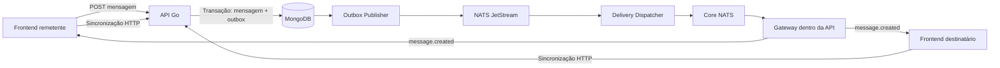
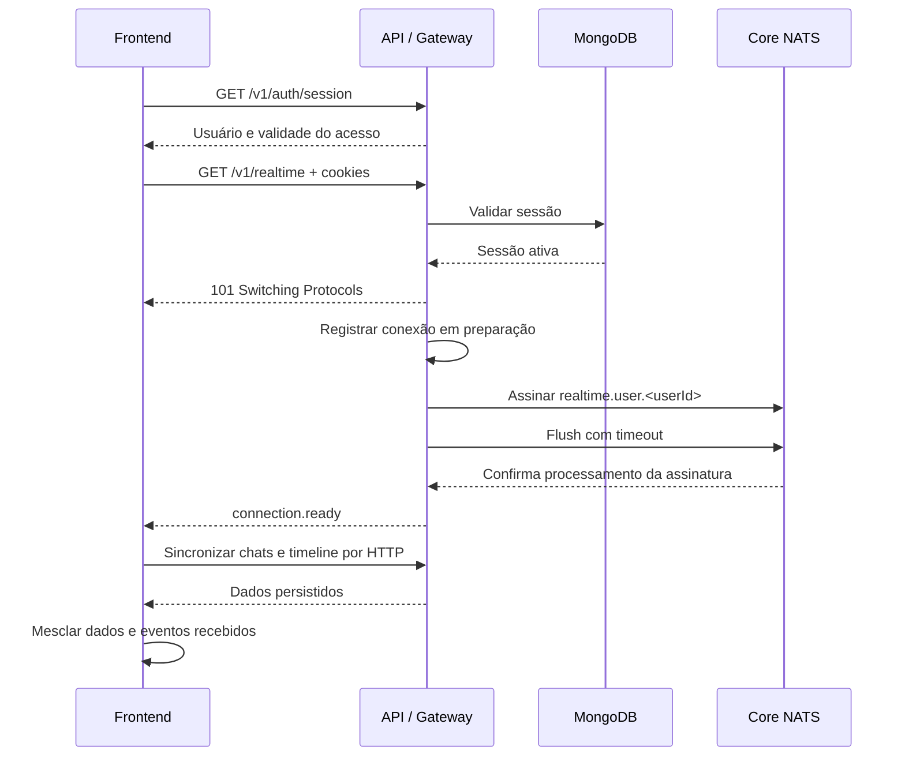

# Guia de implementação — WebSocket e mensagens em tempo real

Data da proposta: 26/10/2026. Implementação iniciada a partir deste guia em 27/10/2026.

Este guia registra o desenho e os critérios de aceite para `nexus-services` e `nexus-modules`. A descrição do estado inicial e os checklists abaixo preservam a proposta original; o estado operacional, os comandos de teste e os pontos de liberação estão em [realtime-operations.md](realtime-operations.md). O WebSocket inicia sempre com a API e com a sessão autenticada do frontend; não há flag de ativação.

**Revisão do frontend em 28/10/2026:** mensagens normais atualizam diretamente o estado da tela pelo WebSocket. O sucesso do POST não invalida queries e o evento não exige GETs de chats/timeline. HTTP fica para carga inicial, histórico, descoberta de conversa ausente e recuperação. O TanStack Query mantém somente o estado das telas montadas, sem persistência local de mensagens; queries sem observadores são descartadas. O fluxo implementado está em [realtime-operations.md](realtime-operations.md).

## 1. Decisões de arquitetura

- O gateway WebSocket será executado dentro do serviço `api`, no processo `cmd/api`, compartilhando a porta HTTP existente.
- Não haverá um novo serviço WebSocket no Docker Compose nesta primeira versão.
- O navegador manterá uma conexão por aba autenticada, válida para todas as conversas do usuário.
- A criação de mensagens continuará usando `POST /v1/chats/{chatId}/messages`.
- O WebSocket entregará eventos de novas mensagens aos participantes, incluindo outras abas do remetente.
- A autenticação continuará usando access token em cookie `HttpOnly` e sessão persistida no MongoDB.
- MongoDB continuará sendo a fonte de verdade. A recuperação após falhas será feita por HTTP.
- O caminho MongoDB → outbox → JetStream → dispatcher será reaproveitado.
- O dispatcher publicará em Core NATS; o gateway assinará os subjects dos usuários conectados.
- O código do gateway ficará isolado para permitir sua extração para um serviço próprio no futuro.

O fluxo de persistência é detalhado em [message-delivery-architecture.md](message-delivery-architecture.md). Este guia complementa aquele documento com o ciclo de conexão, os contratos e as etapas de implementação do WebSocket.

As garantias devem ser interpretadas por etapa: a reentrega do JetStream não se estende automaticamente ao navegador. Core NATS e WebSocket não armazenam notificações para um cliente desconectado.

### 1.1 Escopo da primeira entrega

Inclui conexão autenticada, distribuição de `message.created`, múltiplas abas, reconexão, sincronização incremental, limites de recursos, observabilidade e shutdown.

Ficam para entregas posteriores:

- `message.received` e `message.read`, com persistência de recibos;
- criação de mensagens pelo socket usando `message.send`;
- presença online, indicador de digitação e notificações push;
- edição, exclusão de mensagens e anexos;
- gateway em serviço separado.

Na primeira entrega, o socket não aceitará comandos de negócio do cliente. O canal de leitura continuará ativo para processar frames de controle. A interface continuará usando `PERSISTED` como confirmação do envio: uma escrita no socket não confirma entrega nem leitura.

## 2. Estado atual e alterações necessárias

| Área | Estado observado | Alteração necessária |
| --- | --- | --- |
| Criação de mensagens | Mensagem, sequência e outbox persistidas na mesma transação. | Preservar o caso de uso e sua idempotência. |
| JetStream | Publisher e dispatcher implementados. | Reaproveitar consumidores e retries existentes. |
| Dispatcher | Publica `message.created` somente para o destinatário. | Publicar para ambos os participantes. |
| Evento realtime | Possui `eventId`, `occurredAt`, mensagem e `sequence`. | Adicionar versão pública e propagar `clientMessageId`. |
| Timeline HTTP | Pagina por data e ID; não expõe sequência nem ID do cliente. | Expor os campos e acrescentar modos de paginação por sequência. |
| Autenticação | Valida JWT e sessão; retorna `userId` e `sessionId`. | Expor internamente validade do acesso e acrescentar consulta de sessão. |
| Frontend | Atualiza o cache após o POST e invalida consultas. | Compartilhar reconciliação com os eventos WebSocket. |
| Refresh | Há uma promessa compartilhada dentro de cada aba. | Coordenar renovação também entre abas. |
| Compose | A API não possui configuração de conexão NATS. | Configurar NATS no serviço `api`. |
| Shutdown | Usa `http.Server.Shutdown`. | Encerrar e aguardar sockets explicitamente. |

Arquivos atuais relevantes:

- [Bootstrap da API](../cmd/api/bootstrap.go).
- [Dispatcher](../internal/application/delivery/dispatch.go).
- [Contrato realtime](../internal/ports/realtime.go).
- [Contrato da outbox](../internal/ports/outbox.go).
- [Publisher Core NATS](../internal/resources/nats/realtime_publisher/publisher.go).
- [Autenticação](../internal/application/auth/authenticate.go).
- [Handler da timeline](../internal/drivers/http/handler/chats/timeline.go).
- [Servidor HTTP](../internal/drivers/http/server/server.go).

## 3. Componentes e fluxo



O navegador acessa apenas a aplicação. Não recebe credenciais NATS e não escolhe subjects ou destinatários.

O gateway será composto por:

| Componente | Responsabilidade |
| --- | --- |
| Handler de upgrade | Validar handshake e autenticação; estabelecer a conexão. |
| Hub local | Registrar conexões por usuário e sessão; distribuir eventos localmente. |
| Assinante NATS | Gerenciar assinaturas por usuário ativo; informar falhas e descartes. |
| Conexão | Manter fila de saída, leitura, escrita, heartbeat e prazo de validade. |
| Validador de sessão | Detectar revogação, expiração e indisponibilidade da validação. |
| Gerenciador de shutdown | Bloquear novas conexões, fechar sockets e liberar recursos. |

Uma conexão NATS compartilhada por instância da API é suficiente inicialmente. Não abrir uma conexão NATS para cada socket.

## 4. Abertura e prontidão da conexão

### 4.1 Endpoint proposto

```http
GET /v1/realtime
Upgrade: websocket
```

Usar `ws` apenas no desenvolvimento local sem TLS e `wss` em produção. O endpoint usa o cookie de acesso; nenhum JWT deve ser enviado na URL ou em mensagens de autenticação pelo socket.

O navegador envia cookies aplicáveis automaticamente. Não existe opção `credentials` no construtor `WebSocket`; domínio, caminho, `Secure`, `SameSite` e políticas do navegador precisam permitir o envio do cookie.

### 4.2 Sequência do handshake



Regras de implementação:

1. Validar método, versão do protocolo, origem, limites de conexão e autenticação antes do upgrade.
2. Reservar a vaga de conexão atomicamente; liberar a reserva se o upgrade falhar.
3. Registrar o socket em estado de preparação, com buffer limitado, antes de ativar sua assinatura.
4. Na primeira conexão local daquele usuário, assinar o subject e executar `FlushWithContext` com prazo. Nas demais, reutilizar a assinatura já pronta.
5. Colocar `connection.ready` antes dos eventos de negócio na fila daquele socket. Eventos recebidos durante a preparação devem permanecer no buffer até essa transição.
6. Se houver falha ou estouro do buffer durante a preparação, encerrar a conexão e executar a limpeza.
7. O cliente inicia sincronização somente após `connection.ready`.

O evento `open` do navegador confirma a abertura do transporte. Não confirma que o gateway já está recebendo notificações do NATS. O flush confirma o processamento da assinatura pelo servidor NATS conectado; não comprova entrega ao navegador nem oferece replay de eventos anteriores.

### 4.3 Falhas antes do upgrade

| HTTP | Código proposto | Condição |
| ---: | --- | --- |
| `400` | `invalid_websocket_request` | Handshake inválido. |
| `401` | `unauthenticated` | Acesso ausente, inválido, expirado ou sessão inativa. |
| `403` | `cross_origin_request_rejected` | Origem ausente, `null` ou não permitida para o cliente web. |
| `405` | `method_not_allowed` | Método diferente de `GET`. |
| `429` | `realtime_connection_limit` | Limite de conexões ou tentativas excedido. |
| `503` | `realtime_unavailable` | Gateway indisponível ou em encerramento. |

Após o upgrade, usar fechamento WebSocket. Não tentar escrever um erro HTTP JSON na conexão já promovida.

O JavaScript não consegue consultar o status HTTP de uma falha no handshake pela API WebSocket. Uma falha de abertura não deve, isoladamente, provocar logout ou uma sequência ilimitada de refreshes.

## 5. Autenticação, renovação e logout

### 5.1 Consulta de sessão proposta

```http
GET /v1/auth/session
```

Exemplo de resposta autenticada:

```json
{
  "data": {
    "user": {
      "id": "user-id",
      "email": "pessoa@example.com"
    },
    "accessExpiresAt": "2026-10-26T15:15:00Z"
  }
}
```

Essa rota valida o acesso e a sessão, retorna `401 unauthenticated` quando necessário e usa `Cache-Control: no-store`. Não retorna tokens nem rotaciona o refresh token.

Na inicialização, o cliente consulta essa rota. Em `401`, tenta o refresh HTTP uma vez e repete a consulta uma vez. Esse fluxo substitui o uso de refresh incondicional para descobrir se existe sessão, reduzindo rotações desnecessárias ao abrir várias abas.

### 5.2 Validade da conexão

Acrescentar `AccessExpiresAt` à saída interna da autenticação e à identidade utilizada pelo gateway, obtido dos claims já verificados. Essa informação não deve vir do cliente.

- O prazo máximo da conexão é a expiração do access token usado na abertura.
- O servidor fecha com `4001` quando esse prazo termina.
- O cliente consulta a sessão: se outra aba já renovou o cookie, pode reconectar sem novo refresh; caso contrário, executa a renovação coordenada.
- A renovação ocorre por `POST /v1/auth/refresh`; depois disso, uma nova conexão usa o novo cookie.
- Uma conexão aberta não incorpora automaticamente os cookies renovados pelo navegador.
- Uma sessão revogada ou expirada fecha com `4003`.

Revalidar sessões ativas a cada 60 segundos, inicialmente, com timeout de consulta de 5 segundos. Agrupar por `sessionId` para evitar uma consulta por socket da mesma sessão.

Esse desenho aceita até aproximadamente 65 segundos para detectar revogação remota, considerando intervalo e timeout. Se a consulta não puder validar a sessão, encerrar os sockets afetados com `1013`; não classificá-la como revogada. A conexão também deve respeitar o prazo de expiração da sessão conhecido pelo servidor.

Revogação imediata entre instâncias pode ser adicionada posteriormente com eventos de controle, mantendo a consulta periódica como recuperação.

### 5.3 Coordenação entre abas

A promessa compartilhada em `src/services/auth/refresh-session.ts` protege apenas chamadas dentro da mesma aba. O refresh rotaciona credenciais; duas abas não devem renovar a mesma sessão simultaneamente.

Todos os pontos de refresh, incluindo o cliente HTTP e a reconexão, devem usar o mesmo coordenador:

1. Manter a promessa compartilhada dentro da aba.
2. Adquirir um lock entre abas da mesma origem, por exemplo via Web Locks.
3. Após adquirir o lock, consultar `/v1/auth/session` novamente. Outra aba pode já ter atualizado o cookie.
4. Renovar somente se o acesso ainda estiver inválido; repetir a consulta após sucesso.
5. Liberar o lock e notificar as demais abas via `BroadcastChannel`, enviando apenas sinalização de sessão, sem tokens.

Definir os navegadores suportados antes da entrega. Se não houver Web Locks no conjunto suportado, implementar e testar um mecanismo equivalente de coordenação; apenas emitir mensagens no `BroadcastChannel` não oferece exclusão mútua.

### 5.4 Logout e troca de conta

- Ao iniciar o logout, suspender reconexões e processamento de eventos da sessão atual.
- Fechar o socket, cancelar timers e descartar buffers locais.
- Executar o logout HTTP para revogar a sessão no backend.
- Em sucesso, limpar caches e notificar outras abas. Elas também devem parar seus sockets.
- Em falha de rede, informar que a revogação não foi confirmada; não anunciar logout remoto como concluído.
- Incrementar uma geração local de conexão em logout ou troca de conta. Callbacks e respostas HTTP de gerações anteriores não podem alterar o cache atual.

## 6. Segurança do handshake e isolamento

O gateway deve validar explicitamente o header `Origin` por esquema, host e porta. Reutilizar `HTTP_ALLOWED_ORIGINS` como fonte de configuração inicialmente, sem wildcard.

O middleware HTTP atual não deve ser considerado proteção suficiente por si só. O handshake é um `GET`, e a proteção de origem precisa ser testada especificamente para esse caminho autenticado por cookie.

Requisitos:

- Rejeitar origens não permitidas, ausentes ou `null` no endpoint destinado ao navegador.
- Obter `userId` e `sessionId` exclusivamente da sessão validada.
- Não aceitar subjects NATS, `senderId` ou assinaturas arbitrárias do cliente.
- Validar o formato do ID usado como token do subject, sem separadores ou wildcards NATS.
- Usar TLS em produção e credenciais NATS com permissões mínimas.
- Não registrar cookies, tokens, conteúdo de mensagens ou URLs com segredos.
- Configurar `connect-src` na CSP, quando houver, para permitir o endpoint WebSocket.
- Validar DTOs e tamanho dos eventos também na fronteira NATS → gateway.

Preferir frontend e API sob a mesma origem em produção, com proxy para `/v1`. Em desenvolvimento, usar hosts compatíveis entre si, como `localhost` para ambos, evitando misturar `localhost` com `127.0.0.1`.

## 7. Hub local e assinaturas NATS

### 7.1 Registro de conexões

```text
userId
  └── sessionId
        └── connectionId
              ├── socket
              ├── estado
              ├── fila de saída limitada
              ├── validade do acesso
              └── cancelamento
```

O mapa de usuários e a transição entre zero e uma conexão devem ser protegidos contra concorrência. A primeira conexão cria a assinatura; a última desconexão remove a assinatura. Uma desconexão concorrente não pode remover a assinatura de um usuário que acabou de reconectar.

Não manter locks do hub durante I/O de rede, consultas MongoDB ou espera por escrita em socket. A limpeza da conexão deve ser idempotente, inclusive se leitura, heartbeat e escrita falharem ao mesmo tempo.

### 7.2 Subject por usuário

```text
realtime.user.<userId>
```

Usar `Subscribe`, sem queue group entre gateways. Todos os gateways que possuem conexões daquele usuário precisam receber o evento e distribuir para seus próprios sockets.

Usar uma assinatura por usuário ativo na instância, em vez de uma assinatura por aba ou um wildcard global para todo o tráfego da aplicação.

O callback NATS valida e enfileira o evento. Ele não escreve diretamente no socket e não espera um cliente lento.

### 7.3 Distribuição para ambos os participantes

Alterar `DispatchMessageCreated` para publicar o mesmo evento no subject do destinatário e no subject do remetente.

O dispatcher confirma o evento JetStream somente após concluir ambas as publicações segundo a política existente. Se apenas uma publicação funcionar, o retry pode notificar novamente o primeiro usuário. A deduplicação do cliente precisa tolerar essa situação.

Não gerar um novo `eventId` em cada retry. O `eventId` deve continuar sendo o identificador do evento persistido.

## 8. Protocolo público WebSocket

Todos os eventos da primeira versão usam mensagens de texto JSON em UTF-8. A versão pública do protocolo é independente do nome interno `chat.message.created.v1`.

### 8.1 `connection.ready`

Primeiro evento de aplicação enviado pelo socket:

```json
{
  "version": 1,
  "type": "connection.ready",
  "data": {
    "connectionId": "connection-id",
    "userId": "user-id",
    "accessExpiresAt": "2026-10-26T15:15:00Z"
  }
}
```

O cliente valida a versão e usa o `userId` confirmado pelo backend para derivar `isMine`. O evento não substitui a consulta de dados do usuário.

### 8.2 `message.created`

```json
{
  "version": 1,
  "type": "message.created",
  "eventId": "event-uuid",
  "occurredAt": "2026-10-26T15:00:00Z",
  "data": {
    "id": "message-id",
    "clientMessageId": "018f92d4-2c47-7c87-b33e-d2ea331d2ff2",
    "chatId": "chat-id",
    "sequence": 183,
    "senderId": "sender-id",
    "content": {
      "type": "TEXT",
      "value": "Olá!"
    },
    "createdAt": "2026-10-26T15:00:00Z"
  }
}
```

| Campo | Finalidade |
| --- | --- |
| `version` | Validar compatibilidade do protocolo público. |
| `eventId` | Identificar repetições do evento lógico. |
| `data.id` | Identidade definitiva da mensagem no banco e na interface. |
| `data.clientMessageId` | Reconciliar envio local, resposta HTTP e evento. |
| `data.chatId` | Selecionar a conversa afetada. |
| `data.sequence` | Ordenar e recuperar lacunas dentro da conversa. |
| `data.senderId` | Derivar `isMine` com o usuário autenticado. |

Validar `sequence` como inteiro positivo representável com segurança no JavaScript. O backend não deve emitir valores acima de `Number.MAX_SAFE_INTEGER` no contrato numérico; uma eventual migração para string exige versão compatível.

O `clientMessageId` deve ser propagado desde o documento da outbox, passando pelos DTOs de publicação e consumo, até o evento público. Os eventos já persistidos não possuem esse campo: manter leitura compatível e recuperá-lo da mensagem original quando necessário. Enquanto essa compatibilidade existir, o cliente deve aceitar a ausência em eventos antigos e reconciliar pelo ID persistido.

Um conjunto de IDs de evento em memória pode reduzir processamento repetido, desde que limitado. A identidade da mensagem continua sendo a proteção definitiva contra duplicatas; não manter um histórico ilimitado de `eventId`.

Eventos desconhecidos não devem ser aplicados como mensagens. Registrar diagnóstico e agendar reconciliação com limite de frequência. Versão incompatível interrompe o processamento e solicita atualização da aplicação, evitando reconexões infinitas.

### 8.3 Fechamento

| Código | Significado no projeto | Comportamento do cliente |
| ---: | --- | --- |
| `1000` | Encerramento intencional. | Não reconectar quando houver intenção local de parar. |
| `1001` | Instância encerrando. | Reconectar com espera e sincronizar. |
| `1008` | Violação de política ou comando não suportado. | Interromper o ciclo automático e registrar diagnóstico. |
| `1009` | Mensagem acima do limite. | Interromper o ciclo automático e registrar diagnóstico. |
| `1013` | Indisponibilidade temporária ou consumidor lento. | Reconectar com espera e sincronizar. |
| `4001` | Access token expirado. | Consultar sessão, renovar se necessário e reconectar. |
| `4003` | Sessão revogada ou expirada. | Encerrar estado autenticado e descartar caches. |

`4001` e `4003` são convenções privadas da aplicação. `1006` pode ser observado pelo navegador em uma queda anormal, mas não deve ser enviado como frame de fechamento.

## 9. Timeline, sequência e recuperação

### 9.1 Extensão do DTO

Acrescentar `sequence` ao item da timeline e `clientMessageId` ao objeto `message`, preservando os demais campos:

```json
{
  "id": "message-id",
  "sequence": 183,
  "kind": "MESSAGE",
  "createdAt": "2026-10-26T15:00:00Z",
  "updatedAt": "2026-10-26T15:00:00Z",
  "message": {
    "clientMessageId": "018f92d4-2c47-7c87-b33e-d2ea331d2ff2",
    "senderId": "sender-id",
    "isMine": false,
    "content": {
      "type": "TEXT",
      "value": "Olá!"
    }
  }
}
```

O modo legado por `cursorId` e `cursorCreatedAt` deve continuar funcionando para clientes existentes. O cliente com realtime deve usar um modo por sequência, pois datas podem divergir da ordem de commit em envios concorrentes.

### 9.2 Carga inicial e histórico por sequência

Contrato novo proposto:

```http
GET /v1/chats/{chatId}/timeline?order=sequence&pageSize=50
```

Esse modo retorna as últimas 50 mensagens, em ordem crescente de sequência, e informa:

```json
{
  "data": {
    "items": [],
    "snapshotThroughSequence": 200,
    "pagination": {
      "hasNext": true,
      "nextBeforeSequence": 151,
      "pageSize": 50
    }
  }
}
```

O array acima apenas ilustra o envelope: em uma conversa com sequências de 1 a 200, a resposta real contém os itens 151 a 200. Para carregar o histórico anterior:

```http
GET /v1/chats/{chatId}/timeline?order=sequence&beforeSequence=151&pageSize=50
```

`beforeSequence` é exclusivo. Essa consulta retorna até 50 itens anteriores, também em ordem crescente. `hasNext` indica que ainda há histórico anterior, e `nextBeforeSequence` fica `null` quando ele termina.

A primeira página e `snapshotThroughSequence` precisam vir de uma visão consistente do banco. Usar leitura snapshot em transação curta ou operação equivalente que assegure consistência. Não informar uma sequência máxima cuja cauda não esteja representada na página retornada.

Após essa carga, o cliente pode considerar sincronizada a cauda até 200, sem afirmar que carregou as mensagens 1 a 150. O histórico anterior continua paginado separadamente.

### 9.3 Sincronização incremental

```http
GET /v1/chats/{chatId}/timeline?afterSequence=182&pageSize=100
```

`afterSequence` é exclusivo, inteiro não negativo; `0` permite recuperação desde o início quando necessária. Nesse modo, os itens são retornados em ordem crescente de `sequence`.

Na primeira página, o backend captura um limite superior consistente, por exemplo 200. O cliente o reutiliza nas páginas seguintes:

```http
GET /v1/chats/{chatId}/timeline?afterSequence=190&throughSequence=200&pageSize=100
```

Envelope proposto para uma página que devolve os itens 183 a 190:

```json
{
  "data": {
    "items": [],
    "snapshotThroughSequence": 200,
    "pagination": {
      "hasNext": true,
      "nextAfterSequence": 190,
      "pageSize": 100
    }
  }
}
```

O exemplo omite os itens para destacar a paginação. Na página final, `hasNext` é `false` e `nextAfterSequence` é `null`. Uma resposta vazia não inventa um novo cursor; se o cliente já alcançou o limite da fotografia, pode finalizar a sincronização.

O limite superior impede uma consulta de perseguir indefinidamente mensagens novas. Eventos acima dele ficam no buffer e são processados após a conclusão dessa sincronização.

Regras do backend:

- Autorizar participação no chat em todas as páginas; manter `404 chat_not_found` para inexistência e falta de acesso.
- Usar filtro `sequence > afterSequence` e, quando definido, `sequence <= throughSequence`.
- Usar o índice existente em `(chat_id, sequence)`.
- Limitar `pageSize` entre 1 e 100 e rejeitar parâmetros duplicados ou incompatíveis.
- Não combinar `afterSequence` com cursor de histórico, `beforeSequence` ou `order=sequence`.
- Aceitar `beforeSequence` somente com `order=sequence` e `throughSequence` somente no modo incremental.
- Rejeitar limites negativos, não inteiros, fora da faixa segura ou incoerentes.
- Consultar a fonte primária ou uma leitura que assegure visibilidade dos commits considerados na fotografia.

Acrescentar `lastSequence` à listagem de chats, com valor lido do estado persistido. Ele serve para identificar conversas alteradas; não substitui a consulta de suas mensagens.

### 9.4 Algoritmo do cliente

1. Esperar `connection.ready` e armazenar eventos em um buffer limitado.
2. Atualizar a lista de chats para descobrir conversas novas ou modificadas.
3. Para uma timeline ainda não carregada, consultar sua cauda no modo `order=sequence`.
4. Para uma timeline mantida no cache, recuperar todas as páginas após seu último cursor sincronizado.
5. Mesclar os itens HTTP e os eventos por ID persistido.
6. Reconciliar itens locais pelo par `(senderId, clientMessageId)`, quando disponível.
7. Ordenar por `sequence` e avançar o cursor apenas até a última sequência contígua da cauda conhecida.
8. Aplicar os eventos acima do limite da fotografia. Se houver lacuna, executar nova recuperação.
9. Encerrar o estado `syncing` quando a conversa ativa estiver consistente.

Exemplo: com cursor 182, receber 185 não permite avançá-lo para 185. Recuperar 183 e 184 antes. Também não descartar um evento somente porque sua sequência é menor que o maior número já observado.

O cursor de sincronização acompanha dados que o cliente ainda possui. Se uma página for removida do cache ou a aplicação reiniciar sem histórico persistido, reinicializar a cauda. Não reutilizar um cursor de `localStorage` sem os dados correspondentes.

Conversas nunca abertas não precisam carregar todo o histórico. Atualizar a listagem e carregar a cauda quando forem abertas. Caches inativos podem ser invalidados para nova carga, em vez de sincronizados integralmente.

### 9.5 Quando sincronizar

- Após abertura ou reconexão do socket.
- Ao detectar lacuna de sequência.
- Ao voltar a aba para o primeiro plano ou recuperar conectividade.
- A cada 60 segundos enquanto a aba estiver visível, inicialmente.
- Após uma invalidação de transporte ou um diagnóstico de evento desconhecido.

Uma última notificação pode se perder sem que exista uma próxima mensagem para revelar a lacuna. Por isso, reconciliação periódica e ao recuperar foco fazem parte da primeira entrega.

Coalescer disparos: permitir uma sincronização por chat de cada vez e agendar outra apenas se houver trabalho novo. Limitar concorrência HTTP para evitar picos na reconexão.

### 9.6 Dados anteriores à implementação

Antes de ativar os modos por sequência, verificar documentos antigos sem `sequence` ou `client_message_id`. Os índices atuais são parciais e não comprovam que todos os documentos tenham esses campos.

Se houver dados legados, planejar e validar uma migração que atribua sequência determinística por chat e ajuste `chats.last_sequence`, coordenada com os escritores para impedir colisões. Não gerar sequências fictícias no navegador nem ignorar silenciosamente mensagens sem sequência.

A recuperação por contiguidade pressupõe que a primeira versão apenas acrescente mensagens. Exclusões futuras exigirão tombstones ou outro contrato que explique sequências ausentes.

## 10. Implementação no backend Go

### 10.1 Organização sugerida

```text
internal/
  application/
    auth/                         # consulta de sessão e validade do acesso
    delivery/                     # publicação para os participantes
    timeline/                     # leitura inicial e incremental por sequência
  ports/
    realtime.go                   # DTOs e interfaces sem dependência de NATS/socket
    realtime_subscription.go      # assinatura por usuário e sinalização de falha
  drivers/
    http/
      handler/realtime/           # handshake e upgrade
      handler/auth/               # GET /v1/auth/session
    websocket/
      hub.go                      # conexões e assinaturas locais
      connection.go               # leitura, escrita, heartbeat e cancelamento
      protocol.go                 # codificação e validação do protocolo público
  resources/
    config/realtime.go            # configuração e validações
    nats/realtime_subscriber/     # adaptação das assinaturas Core NATS
```

Os nomes são sugestões. Respeitar as convenções existentes e manter os casos de uso sem dependência da biblioteca WebSocket. A interface de assinatura precisa informar indisponibilidade e descarte, além de permitir cancelamento; um callback apenas para eventos não é suficiente para recuperação correta.

### 10.2 Biblioteca e ciclo de I/O

Biblioteca recomendada: `github.com/coder/websocket`. Na implementação, selecionar e fixar uma versão compatível no `go.mod`, verificando a API dessa versão.

- Definir explicitamente o limite de leitura da biblioteca.
- Desabilitar compressão inicialmente.
- Manter uma única rotina de leitura e uma rotina de escrita de eventos por conexão.
- Manter leitura ativa para que ping/pong e fechamento sejam processados. `Ping` depende da leitura concorrente do pong.
- Não aplicar timeout curto à leitura de dados de uma conexão ociosa saudável; usar heartbeat para detectar queda.
- Usar contexto de vida da conexão ligado ao gerenciador do gateway e ao shutdown. Verificar as particularidades do contexto HTTP após o upgrade.
- Testar upgrade através dos middlewares reais, inclusive o wrapper de recuperação e sua delegação de `ResponseWriter`.
- Encerrar e aguardar as rotinas na limpeza; não deixar goroutines ou timers órfãos.

### 10.3 Configurações propostas

Os valores abaixo são iniciais e precisam ser confirmados por testes de carga. São variáveis novas, exceto `NATS_URL` e `HTTP_ALLOWED_ORIGINS` já usados em outras partes do projeto.

| Variável | Inicial | Uso |
| --- | --- | --- |
| `NATS_URL` | `nats://nats:4222` no Compose local | Conexão NATS da API. |
| `REALTIME_READY_TIMEOUT` | `10s` | Preparação da assinatura e prontidão. |
| `REALTIME_NATS_FLUSH_TIMEOUT` | `5s` | Confirmação da assinatura. |
| `REALTIME_PING_INTERVAL` | `25s` | Intervalo entre pings. |
| `REALTIME_PONG_TIMEOUT` | `10s` | Prazo de resposta ao ping. |
| `REALTIME_WRITE_TIMEOUT` | `10s` | Prazo de escrita por evento. |
| `REALTIME_MAX_MESSAGE_BYTES` | `32768` | Tamanho máximo de uma mensagem lógica. |
| `REALTIME_OUTBOUND_QUEUE_MESSAGES` | `100` | Quantidade de eventos pendentes por socket. |
| `REALTIME_OUTBOUND_QUEUE_BYTES` | `1048576` | Bytes pendentes por socket. |
| `REALTIME_SESSION_CHECK_INTERVAL` | `60s` | Revalidação por sessão. |
| `REALTIME_SESSION_CHECK_TIMEOUT` | `5s` | Prazo para consultar sessão. |
| `REALTIME_MAX_CONNECTIONS_PER_USER` | `10` | Admissão por usuário nesta instância. |
| `REALTIME_MAX_CONNECTIONS_PER_INSTANCE` | `5000` | Teto inicial por processo, sujeito a carga. |
| `REALTIME_SHUTDOWN_TIMEOUT` | `10s` | Orçamento de encerramento do gateway. |

Validar valores positivos, relações entre os prazos e compatibilidade com `stop_grace_period`. O limite por usuário em memória é local: um limite global entre réplicas exige coordenação adicional. Aplicar também rate limit de tentativas por IP e usuário no proxy ou na camada de admissão.

Limitar buffers do assinante NATS e do frontend. Usar inicialmente os mesmos tetos de 100 eventos ou 1 MiB por buffer local, com possibilidade de ajuste. Ao exceder, cancelar o processamento e recuperar a partir do banco; nunca crescer indefinidamente em memória.

## 11. Implementação no frontend React

### 11.1 Organização sugerida

```text
src/
  services/realtime/realtime-client.ts
  services/realtime/realtime-protocol.ts
  services/auth/get-session.ts
  services/auth/session-coordinator.ts
  services/chats/sync-timeline.ts
  hooks/realtime/use-realtime.ts
  app/providers/realtime-provider.tsx
  lib/reconcile-timeline-message.ts
  types/realtime/realtime-event.ts
```

Montar o provider dentro de `ProtectedRoute`, envolvendo o `Outlet`, para acompanhar a sessão sem depender da conversa selecionada. Desmontar ao sair da árvore autenticada.

O efeito que cria a conexão deve limpar timers e callbacks corretamente, inclusive no ciclo de montagem e desmontagem do modo de desenvolvimento do React. Uma renderização ou mudança de chat não deve criar sockets adicionais.

### 11.2 Estados

```text
idle → connecting → syncing → connected
                   ↑             |
                   └─ reconnecting

Qualquer estado → stopped, ao encerrar a sessão ou parar explicitamente.
```

O estado `connected` significa que o transporte está pronto e a conversa ativa terminou sua sincronização. Exibir mensagens simples, como “Conectando…” e “Reconectando…”, sem detalhes de NATS ou infraestrutura.

Falha do transporte realtime não impede o POST HTTP de mensagens quando a API e a sessão estiverem disponíveis. Não manter uma fila offline de novos envios sem requisito específico de produto.

### 11.3 Atualização pelo WebSocket com TanStack Query

Após `message.created`, incorporar a mensagem à timeline aberta e atualizar a posição/data da conversa conhecida. O POST apenas persiste; seu sucesso não invalida queries. A mensagem normal não deve gerar GETs adicionais nem mudar o estado para `syncing`.

O fluxo deve:

- Deduplicar eventos pelo ID persistido e derivar `isMine` da sessão autenticada.
- Ordenar páginas HTTP e mensagens do socket por sequência, preservando os cursores do servidor.
- Preservar eventos diante de uma resposta HTTP anterior; descartá-los da sobreposição quando uma fotografia que já os inclua for carregada.
- Atualizar a ordem da lista com a sequência e a data da mensagem, sem reduzir dados por causa de eventos antigos.
- Recuperar por HTTP após prontidão/reconexão ou lacunas de sequência.
- Consultar metadados de uma conversa ausente da lista carregada em uma descoberta agrupada.
- Usar `staleTime: 0`, `gcTime: 0` e `refetchOnMount: "always"` para consultas de dados; manter apenas o estado necessário enquanto a tela estiver montada.
- Usar `cache: "no-store"` no cliente HTTP e `Cache-Control: no-store` nas respostas da API.
- Concentrar foco/conectividade e verificação periódica no controlador, evitando gatilhos HTTP duplicados nas queries.
- Manter rolagem automática apenas quando apropriada: envio próprio ou usuário próximo ao fim da conversa. Caso contrário, preservar leitura e indicar novas mensagens.

Durante a primeira carga, um buffer transitório limitado preserva eventos até a resposta HTTP. A atualização normal pelo socket não faz HTTP. O estado `syncing` é reservado à recuperação inicial, reconexão e lacunas; verificações periódicas ocorrem em segundo plano.

### 11.4 Reconexão

Usar espera exponencial com aleatoriedade: sortear entre zero e `min(30s, 1s × 2^tentativa)`. Limitar o contador e reiniciá-lo após a conexão permanecer saudável por pelo menos 30 segundos, evitando retries agressivos em conexões que abrem e caem imediatamente.

- Aguardar sinal de conectividade ao ficar offline, sem tratá-lo como prova de acesso ao servidor.
- Usar timeout inicial de 10 segundos para receber `connection.ready`.
- Em falha genérica de abertura, consultar a sessão para distinguir autenticação de transporte; não renovar repetidamente quando o acesso estiver válido.
- Não executar mais de uma tentativa de conexão ou refresh por coordenador ao mesmo tempo.
- Após qualquer reconexão, sincronizar antes de anunciar recuperação completa.
- Impedir timers de reconectar depois de logout, desmontagem ou troca de conta.

## 12. Compose, proxy e disponibilidade

### 12.1 Compose

Mesclar os campos abaixo ao serviço `api` existente; este trecho não é um Compose completo e não substitui suas outras configurações:

```yaml
services:
  api:
    depends_on:
      mongodb:
        condition: service_healthy
      nats:
        condition: service_started
    environment:
      NATS_URL: "nats://nats:4222"
      REALTIME_PING_INTERVAL: "${REALTIME_PING_INTERVAL:-25s}"
      REALTIME_PONG_TIMEOUT: "${REALTIME_PONG_TIMEOUT:-10s}"
      REALTIME_WRITE_TIMEOUT: "${REALTIME_WRITE_TIMEOUT:-10s}"
      REALTIME_SHUTDOWN_TIMEOUT: "${REALTIME_SHUTDOWN_TIMEOUT:-10s}"
```

`service_started` não confirma que o NATS está pronto. O código deve tolerar indisponibilidade e tentar conexão com espera. Configurar e encaminhar as demais variáveis propostas quando necessário, usando os defaults validados pelo backend.

Não adicionar porta pública nem binário WebSocket ao Dockerfile. O endpoint usa a porta da API. O NATS permanece interno à aplicação; a publicação local de sua porta não deve virar acesso do navegador ao broker.

### 12.2 Proxy

- Suportar upgrade WebSocket para `/v1/realtime` usando o fluxo HTTP/1.1 compatível com o gateway.
- Preservar `Origin`, cookies e encaminhamento correto de host/protocolo.
- Configurar timeout de ociosidade acima do ciclo de heartbeat, inicialmente pelo menos 90 segundos.
- Encerrar TLS no ponto definido pela infraestrutura e disponibilizar `wss` ao navegador.
- Rotear novas conexões entre instâncias saudáveis, sem exigir afinidade de sessão.

Cada conexão estabelecida permanece no backend escolhido pelo proxy. A reconexão pode cair em outra instância porque identidade e recuperação dependem do estado persistido, não do hub anterior.

### 12.3 Falha do NATS

Ao perder a conexão NATS, detectar slow consumer ou descarte de mensagens:

1. Marcar o gateway realtime como indisponível.
2. Fechar com `1013` os sockets afetados; em falha global, fechar todos os sockets locais.
3. Impedir `connection.ready` enquanto o transporte não estiver saudável.
4. Restabelecer conexão e assinaturas antes de aceitar prontidão novamente.
5. Deixar os clientes reconectarem e recuperarem pelo HTTP.

Não considerar a reconexão automática do cliente NATS como recuperação dos eventos perdidos. As rotas HTTP de persistência e leitura podem continuar disponíveis durante a indisponibilidade do realtime.

### 12.4 Shutdown

Ao receber sinal de encerramento:

1. Marcar o gateway como em drenagem e rejeitar novas conexões.
2. Parar produtores de eventos para as filas dos sockets.
3. Iniciar fechamento dos sockets com `1001` e prazo total limitado.
4. Cancelar e aguardar rotinas de leitura, escrita, heartbeat e sessão.
5. Remover assinaturas e drenar/fechar a conexão NATS com prazo.
6. Finalizar o servidor HTTP, coordenando os orçamentos de tempo.

`http.Server.Shutdown` não encerra nem aguarda automaticamente conexões WebSocket promovidas. O gateway deve possuir sua própria espera de conclusão. O orçamento total deve caber no `stop_grace_period` do container, atualmente 20 segundos para a API, ou esse prazo deve ser ajustado conscientemente.

## 13. Garantias e cenários de falha

| Situação | Comportamento esperado |
| --- | --- |
| POST confirmado | Mensagem e outbox persistidas; não comprova recebimento. |
| Evento duplicado ou retry parcial do dispatcher | Uma única mensagem lógica na interface. |
| Usuário offline | Recupera mensagens persistidas quando voltar. |
| Socket conectado sem tráfego | Heartbeat verifica transporte; reconciliação detecta perda silenciosa de eventos. |
| Evento antes da resposta HTTP | Item é reconciliado pelo ID ou chave do cliente. |
| Eventos fora de ordem | Ordenar e recuperar lacunas antes de avançar cursor. |
| Cliente lento ou buffer cheio | Fechar, liberar recursos e recuperar por HTTP. |
| NATS indisponível | HTTP pode continuar; realtime fecha e retorna após recuperação. |
| Access token expirado | Consultar/renovar sessão e abrir novo socket. |
| Sessão revogada | Fechar e impedir novas conexões autenticadas com ela. |
| Instância reiniciada | Reconectar em qualquer instância e sincronizar. |
| Página HTTP antiga termina após evento novo | Mesclar sem apagar o estado mais recente. |
| Logout com callbacks em andamento | Geração antiga não modifica o novo estado. |

Nenhuma etapa promete entrega exatamente uma vez de ponta a ponta. A experiência consistente resulta de persistência, idempotência e recuperação pelo banco.

## 14. Observabilidade e capacidade

Métricas mínimas:

- Conexões ativas, abertas, rejeitadas e fechadas por motivo.
- Assinaturas NATS ativas e falhas de conexão ou slow consumer.
- Quantidade e bytes das filas; estouros e timeouts de escrita.
- Latência de prontidão e tempo de sincronização.
- Reconexões, falhas de refresh e sessões invalidadas.
- Eventos inválidos, duplicados e lacunas recuperadas.
- Tempo entre criação persistida e aplicação no cliente, quando houver telemetria adequada.

IDs de usuário, sessão, conexão e mensagem não devem virar labels de métricas de alta cardinalidade. Logs podem usar identificadores de correlação conforme a política do projeto, sem conteúdo ou credenciais.

Antes de produção, registrar o volume esperado de conexões simultâneas, mensagens por segundo e número médio de abas por usuário. Confirmar limites e metas de latência com teste de carga; o teto inicial de 5.000 conexões por processo não representa capacidade já medida.

## 15. Etapas de implementação

### Etapa 1 — contratos, sessão e sincronização

- [ ] Estender os DTOs da timeline e do evento com os campos descritos.
- [ ] Implementar `GET /v1/auth/session` e expor validade interna do acesso.
- [ ] Acrescentar `lastSequence` à listagem de chats.
- [ ] Implementar os modos inicial, histórico e incremental por sequência.
- [ ] Verificar dados legados e preparar migração quando necessária.
- [ ] Propagar `clientMessageId` pela outbox, preservando compatibilidade de eventos antigos.
- [ ] Atualizar os contratos públicos relacionados nesta pasta e os tipos no frontend.

### Etapa 2 — gateway backend

- [ ] Adicionar a biblioteca WebSocket e configurações validadas.
- [ ] Implementar handshake autenticado e validação explícita de origem.
- [ ] Implementar hub, filas limitadas e assinaturas por usuário.
- [ ] Garantir `connection.ready` antes de eventos de negócio.
- [ ] Publicar mensagens para remetente e destinatário.
- [ ] Implementar heartbeat, expiração, revalidação de sessão e limpeza idempotente.
- [ ] Tratar falha NATS, slow consumer e shutdown.

### Etapa 3 — cliente e cache

- [ ] Implementar consulta de sessão e coordenação de refresh entre abas.
- [ ] Criar gerenciador WebSocket e provider na árvore autenticada.
- [ ] Compartilhar reconciliação entre HTTP e realtime.
- [ ] Implementar sincronização com buffer, paginação e cursor contíguo.
- [ ] Implementar reconexão com espera e geração de conexão.
- [ ] Atualizar estado visual, listagem de chats e comportamento de rolagem.
- [ ] Limpar caches, buffers e timers em logout e troca de conta.

### Etapa 4 — infraestrutura e liberação

- [ ] Configurar o NATS na API no Compose.
- [ ] Validar proxy, cookies e upgrade no ambiente de destino.
- [ ] Instrumentar métricas, logs e diagnóstico de falhas.
- [ ] Executar testes de integração e carga compatíveis com o volume esperado.
- [ ] Liberar backend, contratos e cliente realtime de forma coordenada.
- [ ] Verificar os critérios abaixo com o WebSocket iniciado automaticamente, sem flags.
- [ ] Preservar criação/leitura HTTP durante indisponibilidade do transporte realtime.

## 16. Testes e critérios de aceite

### Backend e contratos

- Handshake válido pelos middlewares reais, incluindo cookies e upgrade.
- Rejeição de origem indevida, cookie inválido e sessão revogada.
- Primeiro frame sempre `connection.ready`, inclusive com evento concorrente à assinatura.
- Limites de conexão atômicos e limpeza após falha na preparação.
- Uma assinatura local para várias conexões do mesmo usuário.
- Registro/remoção simultâneos sem perder assinatura ou encaminhar para outro usuário.
- Duas instâncias com o mesmo usuário recebem e distribuem o evento.
- Retry parcial do dispatcher preserva o mesmo evento e notifica ambos os participantes.
- Snapshot e paginação recuperam todas as sequências apesar de commits concorrentes.
- Compatibilidade com eventos e documentos anteriores à mudança.
- Falha NATS, slow consumer e consulta de sessão indisponível fecham conforme o contrato.
- Cliente sem pong, cliente lento e payload inválido liberam recursos.
- Shutdown termina dentro do prazo e não deixa goroutines ou sockets ativos.

### Frontend e experiência integrada

- Dois usuários recebem mensagens sem recarregar a página.
- Outras abas e dispositivos do remetente recebem seus envios.
- Evento antes/depois do POST e eventos duplicados produzem um único item.
- Mensagens fora de ordem e lacunas com mais de uma página são recuperadas.
- Uma última notificação perdida é recuperada sem depender de nova mensagem.
- Desconexão durante carga inicial ou sincronização não perde mensagens.
- HTTP antigo não sobrescreve eventos novos; cursores e histórico continuam válidos.
- Reabertura de aba sem cache não reutiliza cursor sem os dados correspondentes.
- Refresh concorrente entre abas não revoga a sessão por reutilização de token.
- Falha de rede não provoca logout nem tempestade de refresh/reconexão.
- Logout e troca de conta descartam callbacks, buffers e caches da identidade anterior.
- Alternar conversas não cria novos sockets.
- Reiniciar a API ou o NATS provoca recuperação automática e consistente.
- Nenhum evento de conversa alheia é apresentado ao usuário.

Os testes devem comprovar essas propriedades, especialmente concorrência, autorização e recuperação. Ajustar os testes de chat existentes e acrescentar integração real com MongoDB/NATS para as fronteiras que mocks não exercitam.

## 17. Evolução para comunicação de negócio bidirecional

Ao implementar `message.received`, persistir recibos idempotentes por `(messageId, recipientId)`, validar participação e publicar a alteração ao remetente. Recebimento por ao menos uma sessão do usuário pode representar entrega por usuário; leitura exige regra de visibilidade definida pelo produto.

Ao implementar `message.send`, encaminhar o comando ao mesmo caso de uso HTTP, preservando validação, autorização, `clientMessageId`, transação e outbox. A confirmação pelo socket deve ocorrer somente após commit, com correlação da requisição. Não criar uma segunda lógica de persistência dentro do hub.

A extração para um serviço `websocket-gateway` no Compose passa a ser apropriada quando conexões e requisições HTTP exigirem escala, recursos ou ciclos de deploy distintos. O contrato público e o roteamento por usuário devem permitir essa mudança sem alterar a semântica das mensagens.

## 18. Referências

- [Arquitetura de envio e entrega](message-delivery-architecture.md).
- [Contrato HTTP de autenticação](frontend-auth-contract.md).
- [Contrato HTTP de mensagens](frontend-messages-contract.md).
- [Contrato HTTP de chats](frontend-chats-contract.md).
- [Contrato HTTP da timeline](frontend-timeline-contract.md).
- [WebSocket — padrão e handshake com cookies](https://websockets.spec.whatwg.org/).
- [Coder WebSocket — biblioteca Go](https://github.com/coder/websocket).
- [Coder WebSocket — referência de API](https://pkg.go.dev/github.com/coder/websocket).
- [Core NATS — entrega efêmera e pub/sub](https://docs.nats.io/learn/core-nats/).
- [NATS — tratamento de consumidores lentos](https://docs.nats.io/using-nats/developer/connecting/slow).
- [Go — limitações de Server.Shutdown para WebSockets](https://pkg.go.dev/net/http#Server.Shutdown).
- [Web Locks — coordenação entre contextos da mesma origem](https://developer.mozilla.org/en-US/docs/Web/API/Web_Locks_API).
- [BroadcastChannel — comunicação entre abas](https://developer.mozilla.org/en-US/docs/Web/API/Broadcast_Channel_API).
